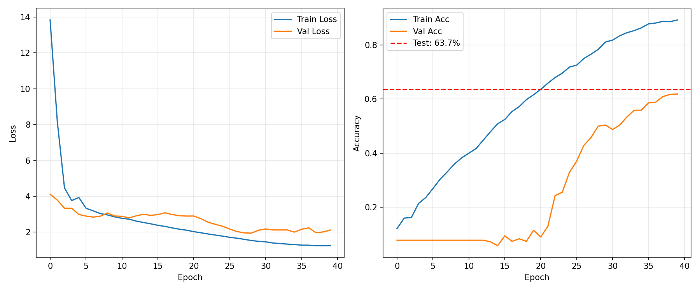
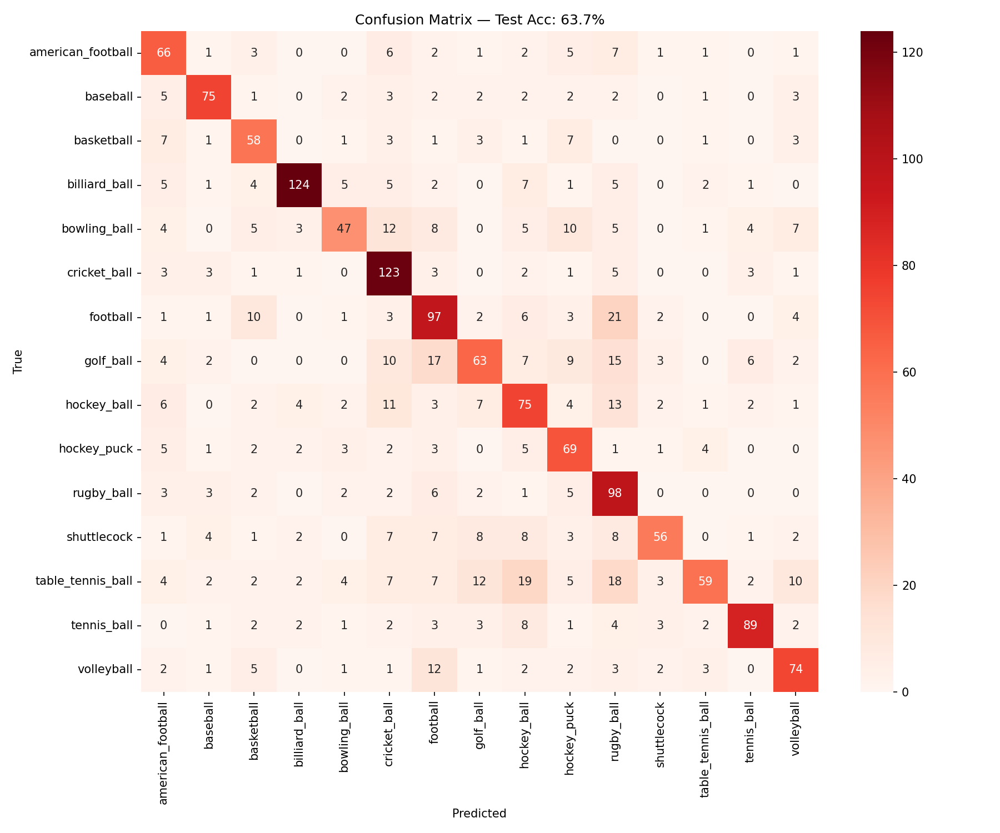
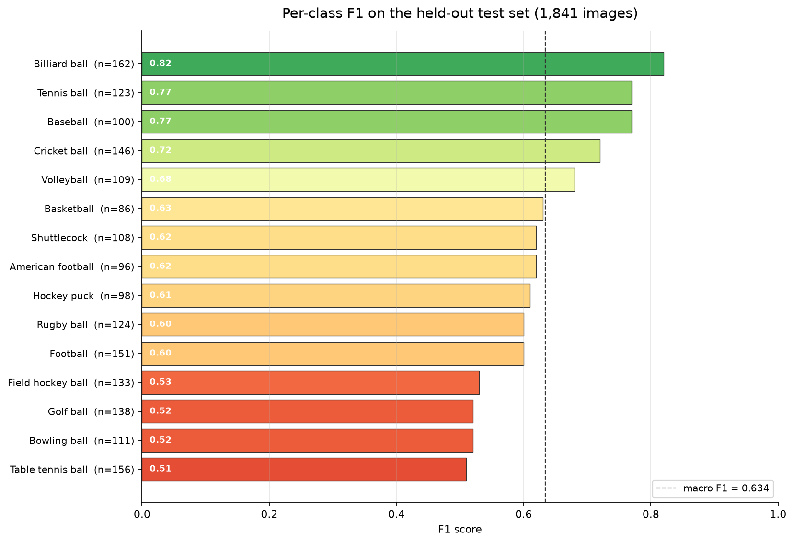
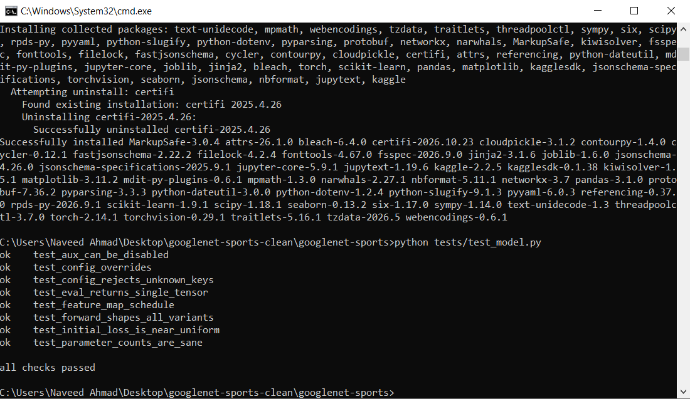

# GoogLeNet Sports Ball Classification — From Scratch in PyTorch

[](https://github.com/naveed1011/googlenet-sports/actions/workflows/tests.yml)
[](https://www.python.org/)
[](https://pytorch.org/)
[](LICENSE)
[](https://www.kaggle.com/datasets/samuelcortinhas/sports-balls-multiclass-image-classification)

I built this project to truly understand how classic CNN architectures work under the hood. Instead of just importing `torchvision.models.googlenet`, I implemented the entire Inception-v1 architecture from scratch — every inception block, the auxiliary classifier, the stem, the training loop — and trained it on a 15-class sports ball dataset.

This is actually my second attempt at this. About seven months ago I built the same model in Keras/TensorFlow and got 55.5% accuracy. When I looked back at it, I realized most of that gap wasn't the architecture — it was my training setup. This repo is the redo: same dataset, same model family, but done properly this time.

> **Result:** **63.72% test accuracy** and **63.42% macro F1** on the 1,841-image held-out split. The Keras version never touched the test set — its 55.49% was validation-only.

---

## Results

| Metric | Value |
|---|---|
| Test accuracy | **63.72%** |
| Test macro F1 | **0.6342** |
| Test weighted F1 | 0.63 |
| Best validation accuracy | 61.89% (epoch 40) |
| Test images | 1,841 across 15 classes |
| Parameters | 8,470,142 (reference run) · 6,502,046 (`src` build) |
| Training | 40 epochs, AdamW + cosine, AMP, EMA |
| Hardware / runtime | Kaggle T4 ×2, ~40 minutes |
| Seed | 42 (reference run) |

The full numbers are in [`docs/results/metrics.txt`](docs/results/metrics.txt) and the per-class report is in [`docs/results/classification-report.txt`](docs/results/classification-report.txt).

### Training curves



*The dashed line is the final test accuracy. It is drawn after training and never used for model selection. The flat validation curve for the first ~20 epochs is real: without a batch norm before the classifier, the initial logits are huge (train loss starts at 13.8) and the model takes a while to escape a single-class prediction. The `src/` build adds a final `BatchNorm2d`; that is the main change I would make before the next full run.*

### Confusion matrix



*Counts, not row-normalised. The diagonal accounts for 1,173 of 1,841 test images (63.72%).*

### Per-class F1



Billiard ball is the cleanest class (0.82 F1, 124 of 162 correct), with baseball and tennis ball close behind at 0.77. The failures concentrate in small, round objects that look alike without context: table tennis ball reaches only 38% recall, with misses spread across field hockey ball (19), rugby ball (18), golf ball (12), and volleyball (10). Golf ball (46% recall) leaks to football (17) and rugby ball (15); bowling ball (42%) leaks to cricket ball (12). The dataset author notes that some images are painted to look like other balls, so part of this is label noise rather than model error.

---

## What I Changed — And Why It Matters

The Keras numbers come from the 28-page notebook export in [`docs/original-keras-notebook.pdf`](docs/original-keras-notebook.pdf); the PyTorch numbers come from the executed run in [`notebooks/googlenet_sports_kaggle.ipynb`](notebooks/googlenet_sports_kaggle.ipynb).

| | My First Version (Keras) | This Version (PyTorch) |
|---|---|---|
| Framework | TensorFlow / Keras | PyTorch |
| Parameters | 10,345,501 | 8,470,142 (reference run) · 6,502,046 (`src`) |
| Auxiliary heads | 2 heads (4.2M params — 41% of total!) | 1 head (2.19M in the reference run; 0.22M in `src`) |
| 5×5 convolution | Real 5×5 conv, no batch norm | Factored into two 3×3 convs, batch norm in every branch |
| Data augmentation | None | Random crop, flip, rotate, color jitter |
| Optimizer | Adam, fixed lr = 1e-5 | AdamW 1e-3, 3-epoch warmup, cosine decay |
| Epochs | 50 | 40 |
| Validation split | 1,465 images (20% of `train/`) | 732 images (10% of `train/`) |
| Test evaluation | Never used the real test set | Test set used exactly once, at the end |

Two numbers need context. The **8.47M** is the reference Kaggle run: a 6.28M backbone plus a 2.19M auxiliary head. The modular `src/` package keeps the same backbone but slims the auxiliary head to 0.22M, so the full model is **6.50M**. The reference run is the one whose metrics are shown above; `src/` is the cleaned-up build that the tests and `configs/default.yaml` target.

The two validation scores are also not a controlled comparison. The Keras run held out 20% of `train/`; the PyTorch reference run held out 10% and kept the official `test/` folder untouched. Read the table as a before/after of the whole setup, not as a single-variable experiment.

---

## The Three Honest Lessons I Learned

**1. The learning rate was the real bug.** A constant 1e-5 over 50 epochs barely moved the model — the loss curve was almost a straight line for the first ten epochs. A sensible schedule plus augmentation does far more than any architecture tweak. This was the biggest single lesson: bad training recipe beats good architecture every time.

**2. 41% of my parameters were wasted.** The two auxiliary classifiers held 4.2 million parameters that get thrown away at inference. Deep supervision helps early training, but one head is enough — and the label-triplication trick I used in Keras was unnecessary; a weighted loss does the same thing cleanly. The reference PyTorch run still spent 2.19M on its single head; the refactored `src` build cuts that to 0.22M.

**3. I never actually tested my model.** My "55.5% accuracy" was a validation number dressed up as a final score. The dataset ships a real `test/` folder with 1,841 images that I never touched. In this version, the test set is locked away until the very end — one single evaluation, no peeking. It scored 63.72%.

---

## Architecture — What I Built

- **Input**: 224×224 RGB, ImageNet normalization
- **Stem**: 7×7/2 conv → max pool → 1×1 conv → 3×3 conv → max pool
- **Nine inception blocks** in three stages (3a–3b, 4a–4e, 5a–5b) with the original paper's filter budget
- **One auxiliary classifier** tapped after block 4d (weight 0.3, training only)
- **Head**: Global average pool → dropout 0.4 → linear classifier; the `src` build adds a batch norm before pooling
- **Backbone**: 6.28M parameters; 8.47M with the reference auxiliary head, 6.50M with the slimmed `src` head
- **Training tricks**: Mixed precision (FP16), EMA weights (decay 0.999), label smoothing 0.1, gradient clipping

### Model variants

All three share the stem and head. `modern` is the default in [`configs/default.yaml`](configs/default.yaml).

| Variant | 5×5 branch | Batch norm | Parameters (aux on) |
|---|---|---|---|
| `modern` | Two 3×3 convs | Every branch | 6,502,046 |
| `bn5x5` | Real 5×5 conv | Every branch | 6,215,614 |
| `v1` | Real 5×5 conv | None | 6,208,654 |

### Training recipe

| Setting | Value |
|---|---|
| Optimizer | AdamW, lr 1e-3, weight decay 1e-4 |
| Schedule | 3-epoch warmup → cosine decay to 1% |
| Batch size | 64 |
| Epochs | 40 |
| Augmentation | Random resized crop (0.7–1.0), horizontal flip, rotation, color jitter |
| Regularisation | Label smoothing 0.1, dropout 0.4, grad clip 1.0 |
| Precision / EMA | AMP FP16 / 0.999 |

---

## How to Run It

### On Kaggle (Recommended — ~40 minutes on free T4 GPU)

1. Create a new Kaggle notebook → attach the **sports-balls-multiclass-image-classification** dataset
2. Upload one of the notebooks in [`notebooks/`](notebooks):
   - [`googlenet_sports_kaggle.ipynb`](notebooks/googlenet_sports_kaggle.ipynb) — the self-contained run that produced the results above (8.47M params, outputs preserved)
   - [`googlenet_sports_torch.ipynb`](notebooks/googlenet_sports_torch.ipynb) — the modular walkthrough that imports `src/` (6.50M params)
3. Turn on GPU: Settings → Accelerator → GPU T4 x2
4. Run all cells

The self-contained notebook writes `metrics.txt`, `classification_report.txt`, `training_curves.png`, `confusion_matrix.png`, and `best_model.pt` to `outputs/`. The modular notebook also writes per-class plots, a confusion breakdown, Grad-CAM visualisations, and `test_results.json`.

### Locally (for development & testing only)

```bash
git clone https://github.com/naveed1011/googlenet-sports.git
cd googlenet-sports

conda create -n googlenet python=3.11 -y
conda activate googlenet
pip install -r requirements-dev.txt

# Run unit tests first (fast, no data needed)
python tests/test_model.py
```

Download the dataset outside Kaggle:

```bash
kaggle datasets download -d samuelcortinhas/sports-balls-multiclass-image-classification
mkdir -p data/sports-balls
unzip sports-balls-multiclass-image-classification.zip -d data/sports-balls
```

Point `data.root` at the folder that contains `train/` and `test/`:

```bash
# Train (needs the dataset downloaded)
python -m src.train --config configs/default.yaml --set data.root=./data/sports-balls

# Evaluate an existing `src/` checkpoint on the test split
python -m src.train --eval-only --checkpoint outputs/best.pt \
  --set data.root=./data/sports-balls
```

Useful overrides:

```bash
--set train.epochs=20              # shorter run
--set model.variant=bn5x5          # real 5×5 conv (compare against factored version)
--set model.aux_weight=0.0         # drop auxiliary head entirely
--set data.batch_size=32           # if GPU runs out of memory
--set train.seed=42                # match the reference run's seed
```

---

## Project Structure

```
googlenet-sports/
├── .github/workflows/tests.yml       # CI: runs the unit tests on every push/PR
├── configs/default.yaml              # All hyperparameters in one place
├── docs/
│   ├── images/                       # README figures
│   ├── results/                      # metrics.txt + classification report
│   └── original-keras-notebook.pdf   # Archived Keras version (PDF export)
├── notebooks/
│   ├── googlenet_sports_kaggle.ipynb # Executed reference run (8.47M params)
│   └── googlenet_sports_torch.ipynb  # Modular walkthrough using src/ (6.50M)
├── scripts/
│   ├── build_notebook.py             # Regenerates the modular notebook
│   └── plot_results.py               # Rebuilds the per-class F1 chart
├── src/
│   ├── model.py                      # Inception blocks, aux head, 3 model variants
│   ├── data.py                       # Dataset loading, augmentation, stratified split
│   ├── train.py                      # Training loop, checkpoints, CLI
│   ├── evaluate.py                   # Test metrics, confusion matrix, Grad-CAM
│   ├── config.py                     # YAML config + dot-notation overrides
│   └── utils.py                      # EMA, LR schedule, meters, plotting
├── tests/test_model.py               # 8 unit tests (shapes, params, config, loss)
├── requirements.txt
├── requirements-dev.txt
├── LICENSE
└── README.md
```

`outputs/` is created at runtime and git-ignored. The files needed to reproduce the README are deliberately copied into `docs/`, so the images and reports keep working on GitHub.

---

## Tests

```bash
python tests/test_model.py
```

```
ok    test_aux_can_be_disabled
ok    test_config_overrides
ok    test_config_rejects_unknown_keys
ok    test_eval_returns_single_tensor
ok    test_feature_map_schedule
ok    test_forward_shapes_all_variants
ok    test_initial_loss_is_near_uniform
ok    test_parameter_counts_are_sane

all checks passed
```

The suite covers forward shapes for all three variants, auxiliary-head on/off, the 1024×7×7 feature map, parameter counts, the initial loss, and config overrides/validation. CI runs the same suite on Python 3.11 via [`.github/workflows/tests.yml`](.github/workflows/tests.yml).

<details>
<summary>Local test run (screenshot)</summary>



</details>

---

## Dataset

[**sports-balls-multiclass-image-classification**](https://www.kaggle.com/datasets/samuelcortinhas/sports-balls-multiclass-image-classification) — 15 classes, 9,169 images: 7,328 in `train/` and 1,841 in the official `test/`. The dataset is **CC0**.

The 15 classes are American football, baseball, basketball, billiard ball, bowling ball, cricket ball, football, golf ball, field hockey ball, hockey puck, rugby ball, shuttlecock, table tennis ball, tennis ball, and volleyball. A few images are painted or otherwise ambiguous, so some of the remaining error is label noise.

---

## What I'm Curious About

I included three model variants so I could run ablation studies:

- `modern` — factored 5×5 (two 3×3 convs), batch norm everywhere
- `bn5x5` — real 5×5 conv (to see what factoring actually buys)
- `v1` — closer to the original 2014 paper

And I can toggle the auxiliary head on/off with `--set model.aux_weight=0.0` to measure deep supervision's real contribution. These are the experiments I want to run next.

---

## Author

**Naveed Ahmad** — GitHub: [@naveed1011](https://github.com/naveed1011)

Built to deeply understand CNN architecture design — from the 2014 Inception paper to modern training recipes.

---

## License

MIT — see [LICENSE](LICENSE). Dataset is CC0.

## Acknowledgements

- Christian Szegedy et al., [Going Deeper with Convolutions](https://arxiv.org/abs/1409.4842) (2014) for the original GoogLeNet architecture.
- Samuel Cortinhas for the [sports-balls dataset](https://www.kaggle.com/datasets/samuelcortinhas/sports-balls-multiclass-image-classification).
- PyTorch and torchvision for the tooling.
